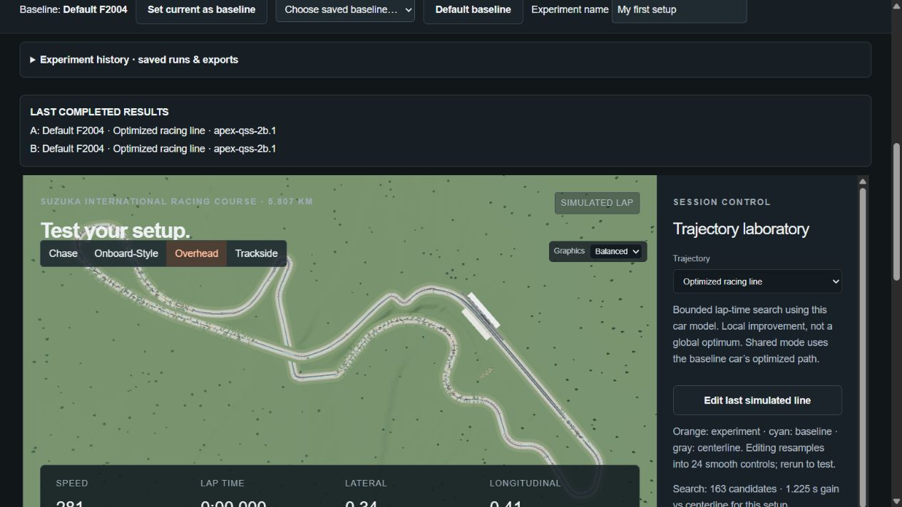
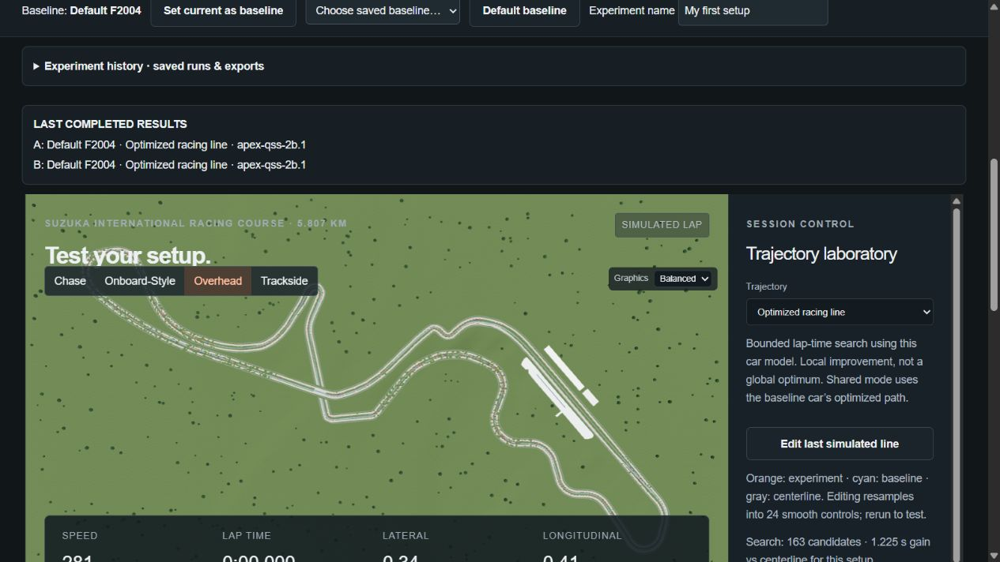
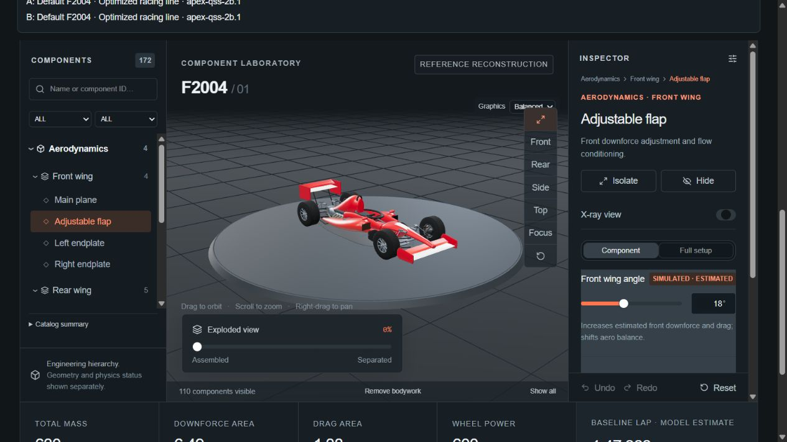
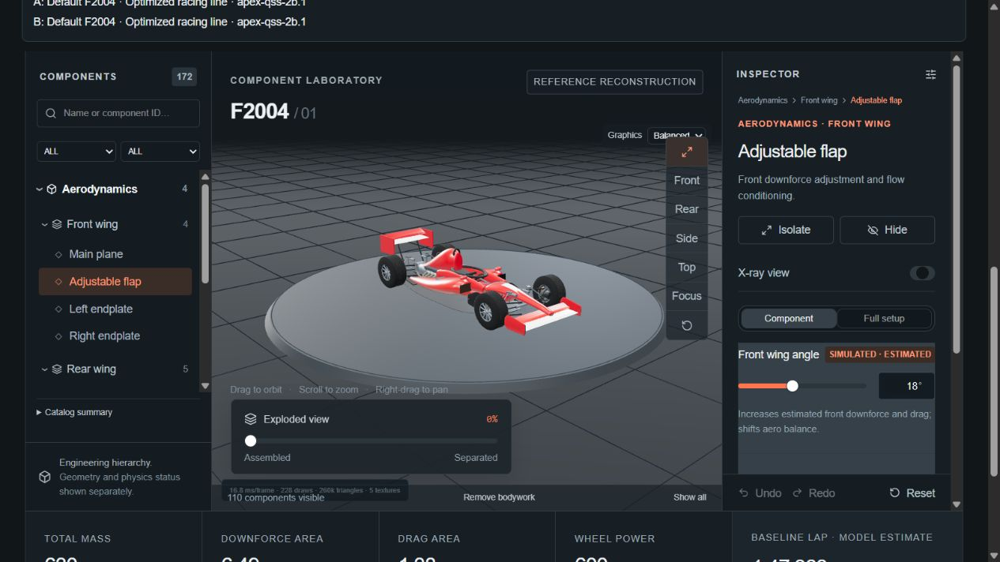
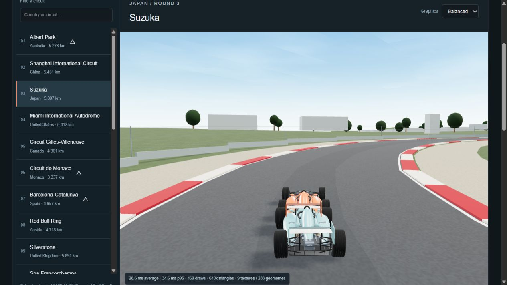
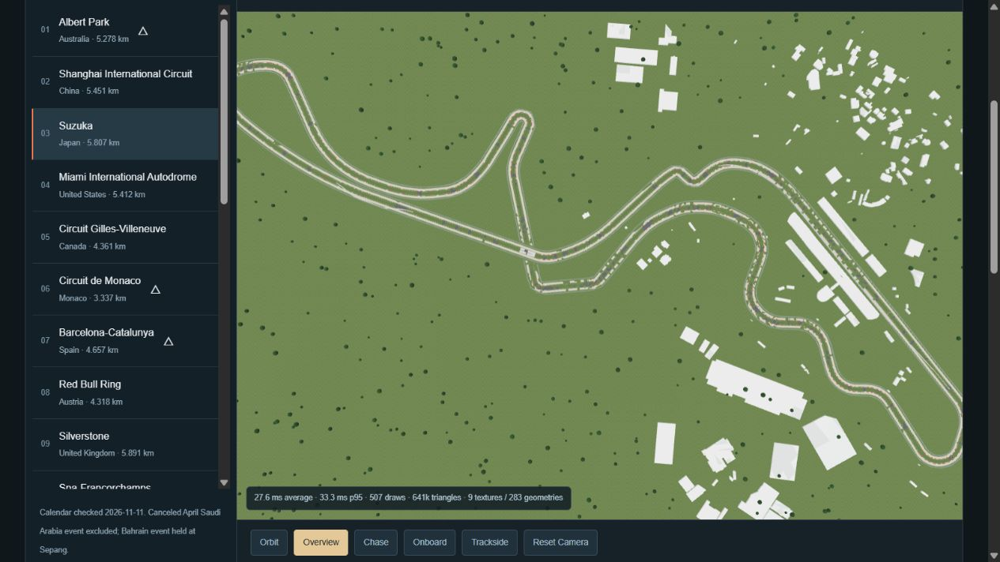

# Graphics and geographic circuit overhaul — 11 November 2026

## What is available

Open **2026 Circuits** from the garage (GitHub Pages: `#circuits`; framework: `/circuits`). All 23 venues on the current F1/FIA calendar have separate, on-demand geographic assets and working F2004/SF-26 physics ghost replay. See [the complete inventory](2026_CIRCUIT_INVENTORY.md). This is source-derived circuit scenery, not photogrammetry or official CAD.

The [current F1 calendar](https://www.formula1.com/en/racing/2026), [FIA calendar](https://www.fia.com/events/fia-formula-one-world-championship/season-2026/2026-fia-formula-one-world-championship), and [F1 Sepang announcement](https://www.formula1.com/en/latest/article/formula-1-and-fia-confirm-that-malaysia-will-join-the-2026-calendar-as-host-venue-for-the-bahrain-grand-prix.6lL7vjFEM2VVynRHvg1TCf) were checked on 11 November 2026: the canceled Saudi April round is excluded, the Bahrain event is held at Sepang in Malaysia, and Madring and Barcelona are distinct venues. Calendar and geography are separate from the historical-data pipeline. No 2025+ observed telemetry or training data was added.

## Sources and accuracy

Each JSON asset retains OSM road/structure IDs, acquisition date, CRS, units, vertical datum, licensing, source limitations and a geometry fingerprint. The concise in-app source panel exposes these distinctions:

- Geographic layout: independently mapped OpenStreetMap ways, ODbL 1.0; source-derived, not survey-verified.
- Landscape: NASA/USGS SRTM version 3 through Open Topo Data, native approximately 90 m. Cached 13 × 13 grids are substantially coarser (actual spacing is recorded per asset and displayed). EGM96 orthometric elevations are metres above mean sea level.
- Road: smoothed DEM height proxy, not surveyed road elevation. It cannot resolve cambers, kerb profiles, road crowns, short crests or tunnel decks. Suzuka's estimated 8 m upper-pass separation is explicitly modeled independently.
- Scenery: OSM building footprints where available; tag-derived or estimated heights, procedural roofs/materials and vegetation. Runoff widths, kerbs and barriers are artistic estimates. Uniform 12 m atlas road width is estimated; measured banking is unavailable.
- Start/finish: nearest source vertex to a researched approximate locator; not an official timing-line survey. Raw length discrepancies are reported rather than hidden by rescaling the whole circuit. Racing direction follows mapped oneway evidence where available; Shanghai and the five map-matched street routes retain a direction-review notice. They are not independently timing-line/corner-order certified.

**Eight provisional layouts:** Albert Park, Monaco, Barcelona, Madring, Baku, Singapore, Las Vegas and Yas Marina. Recent layout changes and public-street junction ordering need independent homologated-plan review. Street routes use an MIT community guide only to select/project onto OSM street segments; the guide is not an official reference. Its RMS/p95 matching residual is recorded. Baku and Las Vegas in particular have material length differences. Do not use these assets as validated 2026 race geometry.

[Full rights and source record](../public/data/atlas-2026/NOTICE.md), [MIT guide notice](../public/data/atlas-2026/LICENSE-guide-MIT.txt), [OSM copyright](https://www.openstreetmap.org/copyright), [Open Topo Data SRTM documentation](https://www.opentopodata.org/datasets/srtm/). Official maps were used as verification references, not copied as textures. No F1 game models, sponsor artwork, satellite photographs or commercial assets are distributed.

## Coordinates and Suzuka correction

Geographic inputs are WGS84 longitude/latitude in degrees. Local conversion uses a circuit-centred equirectangular tangent approximation (R = 6378137 m): X east, Y up, Z south; north is −Z. Distances, widths and heights are metres. Absolute EGM96 heights are reduced by the circuit datum; no ellipsoid/orthometric mixing is performed. Road station increases in the source's intended racing direction. These local kilometre-scale projections are not geodetic survey coordinates.

The old road ribbon's lateral normal and paddock object's local X axis had opposite handedness. A global mirror would reverse the geography. The corrected driver-right vector is (−forward.z, forward.x); a car's local +Z points backward, so its world yaw is heading + π. Grade pitch is applied consistently. Flat banking is disclosed rather than simulated from terrain.

Suzuka's [official July 2026 course guide](https://www.suzukacircuit.jp/course_s/pdf/suzuka_courseguide.pdf), independent OSM pit/main-stand footprints and separate pit-lane geometry establish the sides. Legacy TUM geometry is registered to OSM using cyclic station correspondence and a proper rotation with positive determinant, never nearest-neighbour matching across the crossover. Registration residual is **3.75 m RMS**, scale **0.999794**, with no reflection. The pit building (OSM 184422099) is driver-right; V2 (183394522) and VIP (183394524) are driver-left. Legacy track coordinates and numerical lap baselines remain unchanged.

The lower and upper crossing roads retain separate station identities. The upper pass receives an estimated 8 m separation with a smooth approach; bridge deck/piers are independent of DEM terrain. Ray tests verify upper-road clearance and keep four piers outside the lower corridor. Pit entry/exit follows separate mapped OSM ways; it is a reference marking, not a simulated pit-stop lane.

## Terrain choice and fallback

CesiumJS was evaluated against [Cesium terrain documentation](https://cesium.com/learn/cesiumjs/ref-doc/TerrainProvider.html) and the existing static Three.js architecture. A second renderer/camera, service tokens/quotas and ellipsoid-height reconciliation would add complexity without improving the available road survey. This implementation instead caches open elevation offline and uses one Three.js scene/camera. No accounts, keys, recurring costs or browser secrets are needed.

The app does not contact terrain services at runtime. A local visual clearance cut lowers terrain mesh vertices within one cell diagonal of a road to below nearby road levels; this prevents coarse hillside triangles burying a road (notably Monaco) and preserves the lower level at crossings. This cut is an artistic earthwork approximation, changes no physics elevations, and is not a survey. Asset errors surface with a retry control; simulation remains separate from WebGL failures. Acquisition caches failed/missing DEM values explicitly. The renderer's fallback is estimated nearest-road ground below the road, using the lower nearby road at crossings. Legacy scenes use that disclosed fallback, not newly acquired DEM physics. Atlas physics has a separate model suffix `/atlas-dem-proxy-1`, geometry-fingerprinted versions and exact exported reference paths; historical/engineering archives retain their previous identity.

## Rendering and replay

Both original engineering circuits and the new atlas share textured asphalt, rubber shading, edge paint, grade-aligned kerbs, gravel/grass, instanced barriers/fences/trees, source-positioned buildings, atmospheric sky/fog, ACES tone mapping, sRGB output, PBR paint/clearcoat and environment reflections. No bloom or image-space blur obscures the cars. Garage inspection, component selection/hide/isolate, exploded views and separate F2004/SF-26 geometry/capabilities are preserved.

Atlas supports orbit, overview, smoothed chase, onboard and trackside cameras; seek/restart/rate controls; and up to four independent ghosts with supported power, fuel and grip settings. Wheel rotation uses path distance and each vehicle's tire radius; steering and grade orientation use the replay's physical path. SF-26 remains combustion-only, fixed aero, without modeled suspension. Ghosts do not collide, draft or follow a race strategy. These approximate-road lap times are engineering scenarios, not measured 2026 results or calibrated predictions.

Economy/Balanced/High cap pixel ratio and shadow/terrain/vegetation detail. Noncritical building walls/roofs are merged; repeated scenery is instanced. Only selected circuit JSON loads, with a bounded three-circuit cache. GPU geometry/material/texture resources are disposed when scenes change. Detailed car geometry is retained for inspection; distant-car mesh LOD is not implemented.

## Measurements and validation

Observed in the available in-app Chromium browser at approximately 1265 × 712 CSS pixels; Balanced pixel ratio capped at 1.25. GPU model and dedicated low-end hardware were unavailable. Live overlays report raw requestAnimationFrame durations (not artificially capped animation dt), draws, triangles and GPU resource counts. They are single-host observations, not universal FPS guarantees or VRAM-byte measurements.

| Scene | Observed frame timing | Draws / triangles | Textures / geometries |
| --- | --- | --- | --- |
| Garage, Balanced | ~16.7 ms mean | 228 / 260k | 5 / not sampled |
| Legacy Suzuka + one ghost, Balanced | ~16.5–16.7 ms mean | 394 / 512k | 9 / not sampled |
| Atlas Suzuka, no cars, Balanced | 16.8 ms mean; 24.8 ms p95 | 67 / 122k | 7 / 56 |
| Spa, four SF-26 ghosts, Economy | 27.4 ms mean; 34.1 ms p95 | 622 / 209k | 5 / 651 |
| Atlas Suzuka, two F2004 ghosts, Balanced | 21.5–28.9 ms mean; 39–46 ms p95 | 470–508 / ~641k | 9 / 284 |

Measurements varied with camera/frustum and concurrent local builds. High detail and four cars may be slower; Economy is available. Geometry/texture counts are memory proxies, not a measured browser heap or GPU-byte budget. The initial atlas manifest and one selected circuit load instead of all 23 detailed assets (~1.6 MB total uncompressed JSON).

Automated checks cover geographic round-trip/axis/units, driver-right and proper rotation, source-referenced Suzuka landmark sides, all 23 finite/closed assets, geometry versions, bridge clearance, legacy road-contact/obstacle ray tests, and the actual packaged atlas worker on all 23 venues with deterministic identical ghosts, lap/sector timing, model identity, SF-26 and invalid-input rejection. Legacy lap baselines remain F2004 108.59340246833439 s and SF-26 126.71084397032912 s. Suites run in isolated processes to avoid mutable active-circuit state leaking between tests.

Before/after legacy overhead and garage screenshots use comparable cameras. Browser checks include atlas two-ghost simulation, pause/chase/overview and source panel; final-build checks confirmed circuit switching after chase, Economy quality, and SF-26 simulation with four ghosts. TypeScript, Pages route/base/worker checks, framework production build, original car component/contact/inspection checks and all-calendar numerical worker tests passed. All 23 atlas scenes passed sampled static-obstruction and road-support checks; the three legacy circuits also passed their full-station checks. Road contact/static-scenery tests sample atlas stations; repeated roadside props are excluded from ray queries and use corridor-relative offsets. All venues pass data and numerical worker checks; every venue/camera/hardware combination has not been visually certified. No genuine FastF1 authentication or new real-data regression evaluation is claimed here.

## Screenshots

| Before | After |
| --- | --- |
|  |  |
|  |  |

## Reproduce

Normal install/build remains unchanged; `pnpm build:pages` / `pnpm test:pages` and the framework production build are supported. Runtime needs no geographic service configuration. To reacquire public data, install `requirements-atlas.txt`, run `python scripts/build_circuit_atlas.py`, `python scripts/complete_street_routes.py`, `python scripts/finalize_atlas.py`, `python scripts/register_suzuka.py`, then `python scripts/write_atlas_manifest.py`. Public Overpass/Open Topo Data availability and rate limits apply; acquisition caches live under ignored `work/atlas-cache`. Acquisitions may change source geometry, requiring review, new fingerprints and new experiment provenance.

Run `node tests/run-typescript.mjs verify-geospatial`, `node tests/verify-scene.mjs`, and after the Pages build `node tests/verify-atlas-worker.mjs`. See existing simulator/research verification documents for the broader model and import/storage suites.
