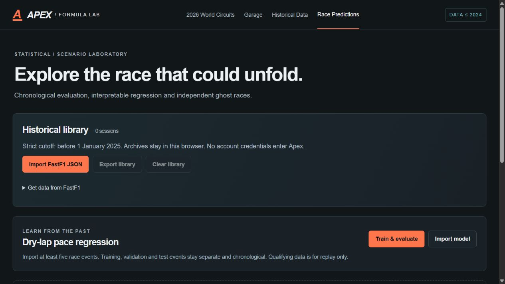
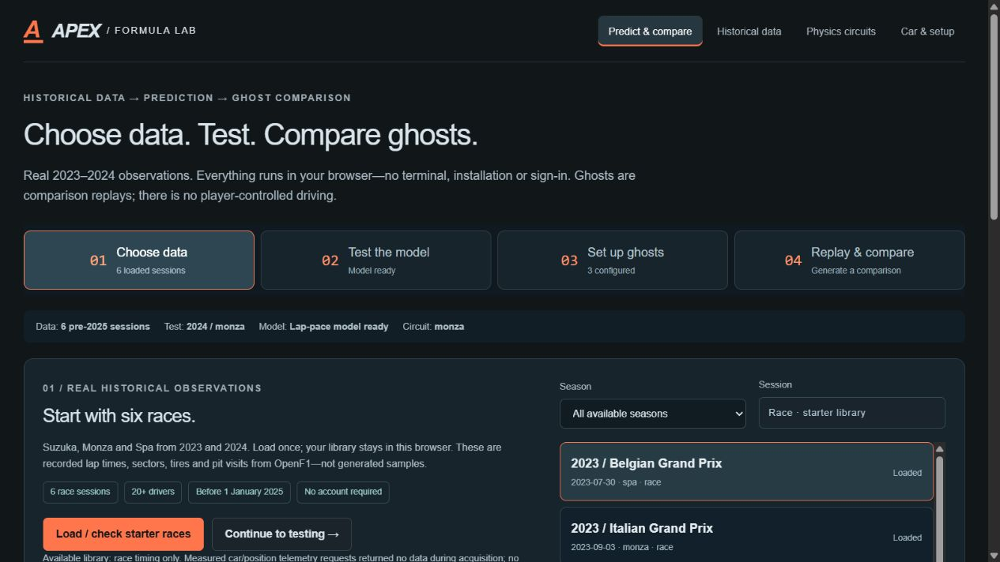
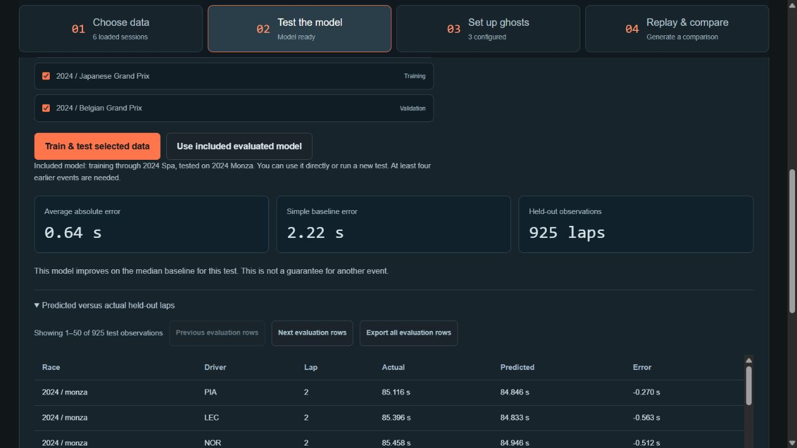
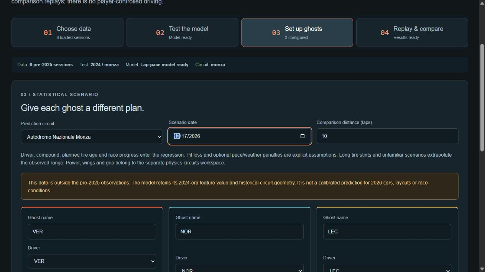
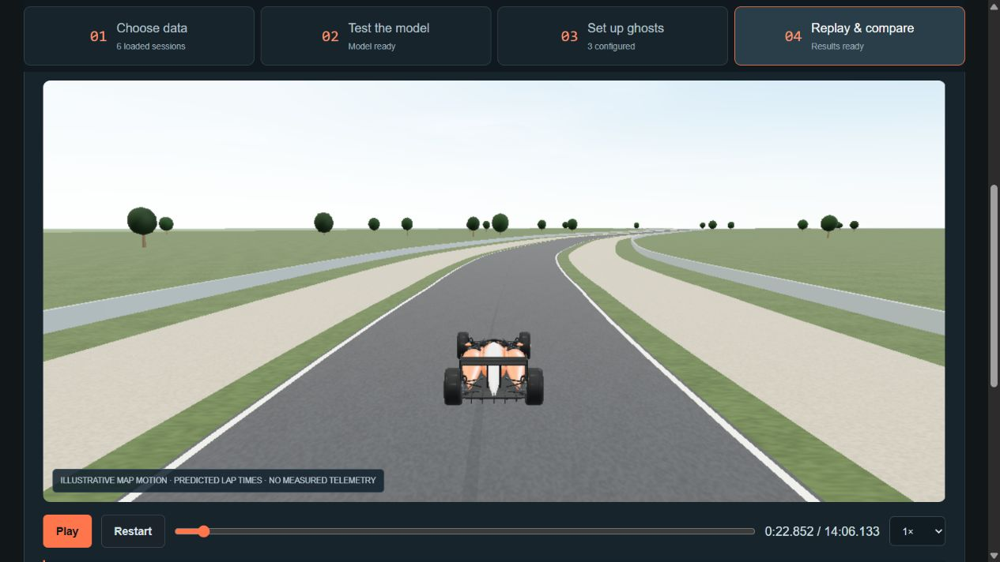
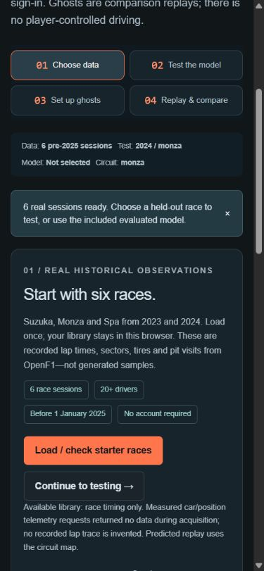
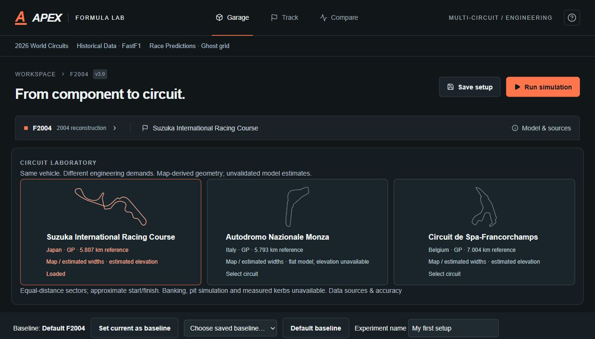
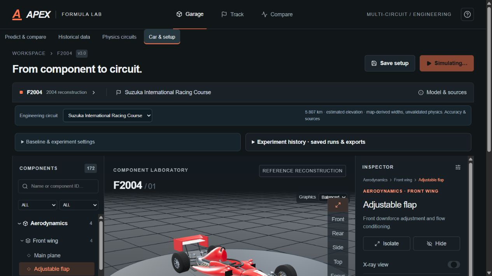

# Browser-only data and ghost workflow — 17 November 2026

## Visitor journey

Open **Predict & compare**. The same four steps are available from **Historical data**:

1. **Choose data:** load six real races, browse 2023/2024, select an event and driver, and inspect recorded lap times. The library is stored in IndexedDB. Load errors have retry/import paths; cancellation retains the previous library.
2. **Test the model:** select a later held-out race and earlier training events. The latest selected earlier event is validation; at least three preceding events fit the model. Or load the included evaluated model without training. Metrics, a median baseline and predicted-versus-actual rows identify the exact test split.
3. **Set up ghosts:** choose a supported historical circuit, comparison length, driver, compound and optional pit plan. Pace/weather penalties are explicit user assumptions, not learned setup effects. Advanced assumptions are expandable. Use **Physics circuits** for actual F2004/SF-26 power, fuel and grip controls; these do not secretly affect the regression.
4. **Replay & compare:** generate independent ghosts, then play/pause, restart, seek, change rate, follow a car and select chase/onboard/orbit/overview/trackside views. A lightweight map works without WebGL. Quality settings reduce rendering cost. Edit settings and rerun; old results remain clearly marked as frozen snapshots.

This is **ghost comparison replay, not player-controlled driving**. Map distance is illustrative and uniform within each predicted lap; an assumed pit loss holds the ghost at the lap boundary. Reference SF-26 geometry does not imply SF-26 prediction accuracy or simulated dynamics. There are no traffic interactions, collision physics or measured replay telemetry in the starter library.

## What changed on the other screens

- One navigation vocabulary links Predict & compare, Historical data, Physics circuits and Car & setup.
- The garage uses a compact circuit selector. Baseline/name controls and experiment history share an expandable tool row; detailed last-result provenance is folded behind a lap-time summary. Run/save and active car/circuit remain visible, bringing the car inspection view higher on the page.
- Circuit source details and scene statistics are expandable. Essential approximate/provisional geometry warnings stay visible. A clear button jumps to physics ghost settings.
- Observed-lap and held-out evaluation tables display 50 rows per page; all observations remain available for computation/export. Imported seasons and qualifying sessions remain browseable, including the existing measured-trace tools.
- Four workflow steps replace an empty-library/import/train/configuration wall. The current data, held-out race, model and circuit remain identifiable. Step navigation stays visible while scrolling; moving steps resets the reading position.
- Supported browser model/ghost drafts persist between workspaces. Library, prior model families, comparison imports/exports and engineering storage remain separate. Imported results are recomputed from the saved model/settings rather than trusted.

## Unexpected lines

Two concrete problems were found:

1. The engineering viewport created an initially visible centreline/racing line, then only applied visibility after a lap existed. It also combined experiment, baseline and reference-centreline overlays under one switch; SF-26 forced them on. New lines start hidden and stay hidden without a valid lap. Modeled paths default off, are labeled by colour, and the useful reference-centreline option has its own switch. SF-26 has an explicit path control. Lap and baseline circuit/version identity are checked before drawing, and baseline geometry refreshes independently when its snapshot changes. This fixes the initialization flash and stale-path transitions and makes intentional guides identifiable; it does not remove pit markings or track geometry.
2. Historical SVG replay filtered out null positions and joined every remaining point with one polyline. That draws straight connectors across missing samples or long gaps. `positionSegments` now breaks on null/nonfinite coordinates, non-increasing time and gaps over two seconds. Observed traces are not forcibly closed. This matches the existing missing-interval rule for the moving ghost. Regression tests cover both missing coordinates and temporal discontinuities.

There was no supplied screenshot of the user's exact line. The investigation reproduced enabled legacy overlays and identified these specific defects; it does not claim every possible visual line has the same cause.

## Terminal requirement audit

Previously, normal visitors faced Python/FastF1 ingestion commands because the production index was empty. Those commands actually acquired data locally; GitHub Pages could not execute them. Local-server, build and authentication commands are developer/authorized data-maintainer tools.

Normal use now requires **no terminal, Python, local server, account, API key or manual FastF1 authentication**. The static site hosts attributed preprocessed snapshots, trains/evaluates in a browser worker, and replays locally. No paid service or backend was added. Optional FastF1 JSON imports remain available under advanced tools. Developer acquisition instructions are linked in documentation, not presented as visitor prerequisites.

## Real data, rights and availability

| Season | Available race sessions | Observed laps |
| --- | --- | --- |
| 2023 | Spa, Monza, Suzuka | 816, 968, 885 |
| 2024 | Suzuka, Spa, Monza | 908, 842, 1009 |

Total **5,428 recorded laps**, approximately 1.55 MB of uncompressed session JSON. The starter model/evaluation add about 140 KB. Sources: [OpenF1 API documentation](https://openf1.org/docs/) and [OpenF1 use/licensing notice](https://openf1.org/). These are unofficial data adapted for non-commercial educational/fan use under CC BY-NC-SA 4.0. See the [full dataset notice](../public/data/fastf1/NOTICE.md). The software's MIT license does not relicense these datasets or derived starter artifacts.

OpenF1 historical data is available without authentication; deployment serves cached snapshots and does not depend on provider uptime. No new FastF1 sign-in was used. Requests for measured car/position traces returned no usable data; the starter library therefore exposes real timing/sectors/tires/pits but **no recorded telemetry replay**. Missing quality flags stay null. Authorized FastF1 imports with measured traces still support the existing trace, channel and calibration tools.

Every observation is before 1 January 2025. Retrieval/model-build timestamps may be later. Scenario dates may be later, but 2025+ observations are rejected and future dates retain the 2024-era year feature. Historical geometry and current 2026 physics circuits are separate. New layouts/cars, long tire stints and changed conditions are out-of-distribution scenarios, not validated forecasts.

## Prediction method and measurements

The new family `apex-ridge-filtered-2` is ridge regression on log lap time, with driver/circuit/year, dry compound, tire age and normalized race progress. OpenF1 lacks the original green-flag, deleted-lap and accuracy fields, so its eligibility check uses positive sectors summing to lap duration within 0.12 s, pit/out-lap exclusion, dry compounds, lap > 1, known tire age, and fixed duration bounds recorded in the dataset notice. This does **not** certify clean green-flag laps. Existing FastF1 filtering is preserved.

The vocabulary comes only from training. Validation chooses regularization; the final fit uses training + validation. The selected later event is excluded from both. User selections cannot include future events relative to the test. Each fit/export retains source hashes, dates and split IDs. Previous `apex-ridge-dry-1` models remain readable.

Starter split: train 2023 Spa/Monza/Suzuka and 2024 Suzuka; validate on 2024 Spa; test on **2024 Monza**. There are **3,851 development laps and 925 held-out eligible laps**. Observed test MAE **0.636 s**, median-baseline MAE **2.218 s**, RMSE **0.966 s**. These are single-event, filtered-lap-cohort results, not generalization guarantees, full-race error bounds or validated finishing-order predictions. The residual envelope is descriptive, not calibrated probability. Scenario progress is normalized to the requested race length; short comparisons are not validated reconstructions of the first N real race laps.

Automated leakage verification changes held-out lap durations and corresponding sector sums while preserving eligibility. Coefficients, baseline values and selected regularization stay identical, while test errors change. Alternate testing on 2024 Spa excludes 2024 Monza entirely. Hash mismatches and future observations are rejected.

## Validation

- TypeScript and Pages/framework production builds; repository base/hash routing, bundled datasets/model and same-origin workers.
- Six real dataset validation, exact included-model coefficients/lineage, selected chronological holdout, actual/predicted rows, cutoff and leakage checks, old-model compatibility, independent ghost settings and missing-position path segmentation.
- Actual packaged workflow worker trained on the six real sessions, returned evaluation rows, generated distinct ghosts and rejected a future-event training selection.
- Existing research, simulator, geometry, motion and storage/import-export regressions remain applicable. Numerical vehicle models were not changed.
- Browser verification: loaded all six races, selected a held-out event, trained/evaluated, changed tire/pit plans, generated three ghosts, used camera/view/playback controls and saved comparison snapshots. Additional browser checks confirmed qualifying/older-year import discovery using an explicitly synthetic QA fixture in ignored work/, three separate SVG segments for missing positions/time gaps, model import, exact-comparison download with frozen model/track/settings, saved-comparison recomputation, 375 CSS-pixel layout without horizontal overflow, catalog-failure recovery, and cancellation under an isolated delayed-response preview. The QA fixture and preview configuration are excluded from publication.

Screenshots use the available desktop browser. Device/GPU-specific frame-rate promises are not made. The map is the lowest-cost fallback; 3D keeps bounded car counts and supports Economy quality. Shared resources are disposed on replay/circuit/quality changes.

## Screenshots

| Original garage | Compact engineering workspace |
| --- | --- |
|  |  |

## Developer reproduction

Visitors do not need these commands. Maintainers can reacquire the public historical snapshots with `python scripts/build_openf1_library.py` (public endpoint rate limits apply), then regenerate the model with `node scripts/build-starter-model.mjs`. Reacquisition changes retrieved-at metadata/content identities and requires rebuilding the model. Raw source responses stay under ignored `work/openf1-cache`.

Run `node tests/run-typescript.mjs verify-workflow verify-research`, then the Pages build and `node tests/verify-workflow-worker.mjs` / `node tests/verify-pages.mjs`. The existing source ZIP includes the current code, data attribution and datasets while excluding caches and credentials.
